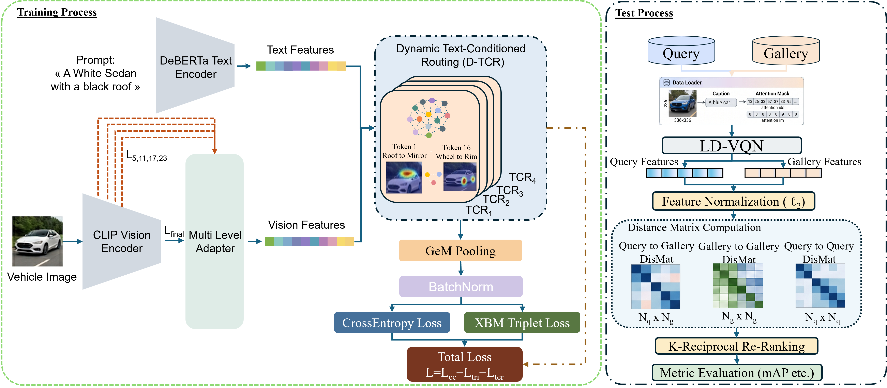

# LD-VQN: Linguistically Driven Visual Query Network for Vehicle Re-Identification

[](https://doi.org/10.1016/j.neucom.2026.135646)
[](https://pytorch.org/)
[](LICENSE)
[](https://colab.research.google.com/github/AdmAnders/LD-VQN-Reid/blob/main/notebooks/LD-VQN_Colab.ipynb)
[](https://creativecommons.org/licenses/by-nc/4.0/)

Official PyTorch implementation of

> **A large-scale multimodal benchmark and linguistically driven network for vehicle re-identification**
> Hidayet Ergin, Ali Seydi Keçeli
> *Neurocomputing*, vol. 713, 135646, 2027. DOI: [10.1016/j.neucom.2026.135646](https://doi.org/10.1016/j.neucom.2026.135646)

LD-VQN is a cross-modal architecture for fine-grained vehicle re-identification. Together with the code we release
**T2I-VeRi-776, T2I-VehicleID and T2I-VeRi-Wild**, natural-language descriptions for every image of the three
standard vehicle re-ID benchmarks (808K descriptions in total).

<div align="center">
  
  <p><em>Figure 1: Overall architecture of LD-VQN.</em></p>
</div>

## Highlights

- **808K multimodal corpus:** T2I-VeRi-776, T2I-VeRi-Wild and T2I-VehicleID add dense textual descriptions to the three benchmarks, covering both overall shape and instance-level details (decals, grille geometry, ...).
- **Multi-Level Adapter (MLA):** fuses intermediate CLIP ViT-L/14 layers (5, 11, 17, 23) so early texture cues are not lost.
- **Dynamic Text-Conditioned Routing (D-TCR):** the caption predicts the adjacency between latent component nodes, which then attend to image regions and route the information back to the text tokens.
- **Orthogonal disentanglement loss:** pushes the latent nodes towards mutual orthogonality to prevent attention collapse.

---

## Contents

1. [Quick start on Google Colab](#quick-start-on-google-colab)
2. [Repository structure](#repository-structure)
3. [Installation](#installation)
4. [Data preparation](#data-preparation)
5. [Pretrained weights](#pretrained-weights)
6. [Evaluation](#evaluation)
7. [Training](#training)
8. [Visualization](#visualization)
9. [Reproducibility notes](#reproducibility-notes)
10. [Citation](#citation)
11. [License](#license)

## Quick start on Google Colab

The easiest way to run LD-VQN is the Colab notebook
[`notebooks/LD-VQN_Colab.ipynb`](notebooks/LD-VQN_Colab.ipynb)
([open in Colab](https://colab.research.google.com/github/AdmAnders/LD-VQN-Reid/blob/main/notebooks/LD-VQN_Colab.ipynb)).
It clones the repository, installs the pinned model/tokenizer packages, copies the images of one dataset from your
Google Drive to the Colab disk and then lets you

1. check the setup (`tools/check_setup.py`: caption counts, missing images, GPU memory),
2. run a ~10-minute pipeline test on the real data,
3. evaluate the released weights,
4. train with checkpoints on Drive (re-running the notebook resumes an interrupted run),
5. draw the attention maps and the t-SNE plot.

You need a GPU runtime and the dataset archive (VeRi-776, VehicleID or VERI-Wild – see
[Data preparation](#data-preparation)) in your Drive. The paper setting needs a large GPU (A100 80 GB / H100);
on smaller GPUs set `LOW_MEMORY = True` in the notebook.

## Repository structure

```text
├── configs/                       # one YAML per dataset (all hyper-parameters)
│   ├── veri776_ldvqn.yml
│   ├── vehicleid_ldvqn.yml
│   └── veriwild_ldvqn.yml
├── datasets/
│   ├── base_dataset.py            # shared image-text dataset (image, input_ids, mask, pid, filename)
│   ├── veri776_dataset.py         # VeRi-776 split / path / identity parsing
│   ├── vehicleid_dataset.py       # VehicleID (identity lookup + query/gallery construction)
│   ├── veriwild_dataset.py        # VERI-Wild (nested or flat image folders)
│   ├── samplers.py                # P x K RandomIdentitySampler
│   ├── build_dataloader.py        # transforms, tokenizer, loaders
│   ├── T2I-VeRi-776/              # captions: image_{train,query,test}.jsonl
│   ├── T2I-VehicleID/             # captions: train_list.jsonl, test_list_{800,...,13164}.jsonl
│   └── T2I-VeRi-Wild/             # captions: Veri_Wild_captions_{train,test_*_query,test_*_gallery}.jsonl
├── models/
│   ├── ld_vqn.py                  # LD-VQN (CLIP + MLA + D-TCR x4 + GeM + BNNeck)
│   ├── mla.py                     # Multi-Level Adapter
│   ├── d_tcr.py                   # Dynamic Text-Conditioned Routing
│   ├── text_encoders/deberta_encoder.py
│   └── losses/
│       ├── orthogonal_loss.py     # orthogonal disentanglement loss
│       └── xbm_triplet.py         # cross-batch memory + batch-hard triplet loss
├── utils/                         # config, seeding, environment report, k-reciprocal re-ranking, mAP/CMC
├── notebooks/
│   └── LD-VQN_Colab.ipynb         # Google Colab: setup, test, evaluation, training, figures
├── scripts/                       # train_*.sh, eval_*.sh, extract_attention.sh
├── tools/
│   ├── check_setup.py             # pre-flight check of data, captions and GPU
│   ├── visualize_attention.py     # Fig. 9: cross-modal attention maps
│   └── tsne_visualization.py      # Fig. 11: t-SNE of the embedding space
├── weights/                       # put downloaded checkpoints here (see weights/README.md)
├── train.py                       # training loop (Algorithm 1)
├── test.py                        # evaluation (mAP / Rank-k)
├── requirements.txt               # pinned pip dependencies (local machines / Docker)
├── requirements-colab.txt         # pinned model/tokenizer packages on top of Colab's torch
├── environment.yml                # conda environment
├── Dockerfile
├── CITATION.cff
└── LICENSE
```

## Installation

Tested on Linux with Python 3.12 and an NVIDIA GPU. All versions are pinned in `requirements.txt`.

> **Windows:** the PyPI `torch` wheel for Windows is CPU-only. Install the CUDA build of `torch==2.15.0` /
> `torchvision==0.29.2` first with the command from <https://pytorch.org/get-started/locally/>, then
> `pip install -r requirements.txt`. The `scripts/*.sh` files need bash; on Windows call `python train.py ...` /
> `python test.py ...` directly.
>
> **IDEs (e.g. PyCharm):** set the working directory of every run configuration to the repository root – all paths
> in the configs are relative to it.

**Option 1 – conda**

```bash
git clone https://github.com/AdmAnders/LD-VQN-Reid.git
cd LD-VQN-Reid
conda env create -f environment.yml
conda activate ldvqn
```

**Option 2 – pip / virtualenv**

```bash
git clone https://github.com/AdmAnders/LD-VQN-Reid.git
cd LD-VQN-Reid
python3.12 -m venv .venv && source .venv/bin/activate
pip install -r requirements.txt
```

**Option 3 – Docker**

```bash
docker build -t ldvqn .
docker run --gpus all --shm-size=16g -it --rm \
  -v /path/to/data:/workspace/LD-VQN-Reid/data \
  -v /path/to/weights:/workspace/LD-VQN-Reid/weights \
  ldvqn bash scripts/eval_veri776.sh
```

The CLIP (`openai/clip-vit-large-patch14-336`) and DeBERTa (`microsoft/deberta-v3-base`) backbones are downloaded
from the Hugging Face Hub on first use (~2.1 GB).

## Data preparation

Run `python tools/check_setup.py --config configs/<dataset>_ldvqn.yml` after preparing the data: it reports caption
counts, identities, missing images and fallback captions per split.

### 1. Vehicle images (not distributed here)

> **This repository does not contain or redistribute any vehicle images.** VeRi-776, VehicleID and VERI-Wild are
> owned by their original authors and are released for non-commercial research under their own terms.
> Please request / download them from the original sources and cite the original papers:
>
> | Dataset | Where to get it |
> |---|---|
> | VeRi-776 | <https://vehiclereid.github.io/VeRi/> (request by e-mail to the dataset authors) |
> | PKU VehicleID | <https://www.pkuml.org/resources/pku-vehicleid.html> |
> | VERI-Wild | <https://github.com/PKU-IMRE/VERI-Wild> |

Place the images under `data/` (or change `DATA.IMAGE_ROOT` in the config):

```text
data/
├── VeRi/                          # VeRi-776
│   ├── image_train/  0001_c001_00016450_0.jpg ...
│   ├── image_query/
│   └── image_test/
├── VehicleID/                     # PKU VehicleID (VehicleID_V1.0)
│   ├── image/        0000001.jpg ...
│   └── train_test_split/
│       ├── train_list.txt         # "<image_id> <vehicle_id>"
│       └── test_list_{800,1600,2400,3200,6000,13164}.txt
└── VeRi-Wild/                     # VERI-Wild
    └── images/       <vehicle_id>/<image_id>.jpg   (a flat images/<image_id>.jpg layout also works)
```

### 2. Captions (this repository)

The captions are JSON-lines files, one line per image:

```json
{"filename": "0002_c003_00084280_0.jpg", "id": "0002", "caption": "A yellow hatchback viewed from the rear. ..."}
```

| Field | Required | Notes |
|---|---|---|
| `filename` | yes | image file name inside the split folder |
| `caption`  | yes | natural-language description (lines without it fall back to `"A vehicle."`) |
| `id`       | VeRi-Wild | vehicle identity. VeRi-776 parses it from the file name; VehicleID looks it up in `train_test_split/*.txt` |

Additional fields (e.g. `attributes`, `confidence`) are ignored by the code.

| Caption set | Files | Status in this repo |
|---|---|---|
| T2I-VeRi-776  | `datasets/T2I-VeRi-776/image_{train,query,test}.jsonl` | **complete** (37,778 / 1,678 / 11,579 lines) |
| T2I-VehicleID | `datasets/T2I-VehicleID/{train_list,test_list_*}.jsonl` | **demo subset** – full files: see below |
| T2I-VeRi-Wild | `datasets/T2I-VeRi-Wild/Veri_Wild_captions_*.jsonl` | **demo subset** – full files: see below |

The VehicleID and VeRi-Wild files in the repository are small demo subsets that show the format and let you run the
pipeline end-to-end. Because of their size, the full caption files are distributed separately:
**TODO: download link** (or contact <hidayetergin@hacettepe.edu.tr>). Copy them over the demo files with the same names.

## Pretrained weights

Download the checkpoints from the [`v1.0` release](https://github.com/AdmAnders/LD-VQN-Reid/releases/tag/v1.0)
into `weights/` and check their SHA256 sums (listed in [`weights/README.md`](weights/README.md)).

| Dataset | Checkpoint | Test split | mAP | Rank-1 |
|---|---|---|---|---|
| T2I-VeRi-776 | `weights/ldvqn_veri776.pth` (epoch 60) | query / test | see paper | see paper |
| T2I-VehicleID | `weights/ldvqn_vehicleid.pth` | 800 / 1600 / 2400 | see paper | see paper |
| T2I-VeRi-Wild | `weights/ldvqn_veriwild.pth` | 3000 / 5000 / 10000 | see paper | see paper |

All numbers use k-reciprocal re-ranking and the evaluation protocol described in
[Reproducibility notes](#reproducibility-notes).

## Evaluation

```bash
# VeRi-776 – image_test and image_query
bash scripts/eval_veri776.sh weights/ldvqn_veri776.pth

# VehicleID – 800 / 1600 / 2400 test splits
bash scripts/eval_vehicleid.sh weights/ldvqn_vehicleid.pth

# VeRi-Wild – 3000 / 5000 / 10000 test splits
bash scripts/eval_veriwild.sh weights/ldvqn_veriwild.pth
```

Or call `test.py` directly:

```bash
python test.py --config configs/vehicleid_ldvqn.yml --weights weights/ldvqn_vehicleid.pth \
               --test_sizes 800 1600 2400 --output results/vehicleid.json
python test.py --config configs/veri776_ldvqn.yml --weights weights/ldvqn_veri776.pth --no_rerank   # without re-ranking
```

Results are printed and, with `--output`, written to a JSON file.

## Training

```bash
bash scripts/train_veri776.sh
bash scripts/train_vehicleid.sh
bash scripts/train_veriwild.sh
# equivalent: python train.py --config configs/veri776_ldvqn.yml
```

- Outputs go to `EXPERIMENT.OUTPUT_DIR` (e.g. `outputs/veri776/`): `config.yml`, `ldvqn_checkpoint.pth` (written every
  epoch) and `ldvqn_best.pth` (best mAP).
- Re-running the same command **resumes automatically** from `ldvqn_checkpoint.pth` (model, optimizer, scheduler,
  XBM memory and RNG state).
- Any config value can be overridden from the command line:
  `python train.py --config configs/veri776_ldvqn.yml --opts SOLVER.EPOCHS 30 EXPERIMENT.OUTPUT_DIR outputs/run2`

Batch-hard triplet mining and BatchNorm depend on the physical batch, and mixed precision changes the numerics,
so results can differ from the paper. `SOLVER.MAX_ITERS_PER_EPOCH 20` truncates every epoch for a quick pipeline
test.

## Visualization

```bash
# Fig. 9 – D-TCR attention of the latent nodes over the image, conditioned on a caption
bash scripts/extract_attention.sh data/VeRi/image_query/0002_c003_00084280_0.jpg \
     "A yellow hatchback viewed from the rear. It has yellow roof, light tone."

# Fig. 11 – t-SNE of the retrieval embeddings of 10 random gallery identities
python tools/tsne_visualization.py --config configs/veri776_ldvqn.yml \
       --weights weights/ldvqn_veri776.pth --num_ids 10 --output outputs/tsne_veri776.png
```

## Reproducibility notes

- **Captions are used at test time.** Every query and gallery image is encoded together with its caption; the
  model cannot be evaluated on images alone.
- **VehicleID query/gallery.** For each identity of a test list, one image is put in the gallery and the remaining
  images are queries. By default the first image of the identity in the original `test_list_*.txt` order is used
  (`DATA.GALLERY_SELECTION: first`, deterministic); `random` picks it with `DATA.SPLIT_SEED`.


## Citation

```bibtex
@article{ERGIN2027135646,
  title   = {A large-scale multimodal benchmark and linguistically driven network for vehicle re-identification},
  author  = {Hidayet Ergin and Ali Seydi Keçeli},
  journal = {Neurocomputing},
  volume  = {713},
  pages   = {135646},
  year    = {2027},
  issn    = {0925-2312},
  doi     = {10.1016/j.neucom.2026.135646},
  url     = {https://www.sciencedirect.com/science/article/pii/S0925231226030444}
}
```

## License

- **Captions** (T2I-VeRi-776, T2I-VehicleID, T2I-VeRi-Wild): [CC BY-NC 4.0](https://creativecommons.org/licenses/by-nc/4.0/).
- **Images:** not included; governed by the licenses of the original datasets.

## Contact

Hidayet Ergin – <hidayetergin@hacettepe.edu.tr>
